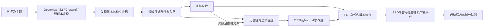

# 拉取效率深度分析与项目调研

分析日期：2026-10-13，上海时间。正式数据库取证：15:35:33；补充取证与隔离复现：15:40:48；节流记录复现：15:45:51。

## 结论与优先次序

当前拉取已经有完整的发现、直链、多来源回退、身份检查、持久重试、SSD落盘和原子领取链路。继续增加总并发，收益预计有限。应先解决**不同来源的冷却互相拖累、冷却状态没有双向同步、有效候选不足、回退重复解析和重复查源**，再试验新的被引关系和全文来源。

建议依次实施：

1. 统一来源身份和限流状态；区分元数据请求与PDF传输。
2. 改成每个来源独立退避，在领取前判断是否存在合法可运行来源。
3. 共用有期限的元数据缓存，复用已取得的题名、DOI、书目和来源响应。
4. 给种子参考文献和被引文献设置独立来源游标，按真实新增收益安排检索。
5. 分别对 OpenCitations、OpenAlex 缓存PDF做隔离对照，证实净增益再纳入生产。

本次完成源码分析、只读账本取证、项目检索、隔离复现和现有回归验证。生产源码、配置、暂停、队列和服务未修改；新增的是本报告和三份审计快照。此报告提出的改动尚未实施，也没有新增原文下载实测。

## 取证方法与统计边界

数据库采用 SQLite `mode=ro`、`query_only=ON` 和单次读事务，没有实例化正式 Catalog，避免构造函数执行迁移。运行JSON另行读取并保留各自观测时间和文件哈希。代码结论绑定快照中的源码哈希。

- [24小时基线及源码指纹](/Users/xiaoyanhao/project/paper/data/audit_index/fetch-deep-research-20261013T153533.json)
- [补充账本与429隔离复现](/Users/xiaoyanhao/project/paper/data/audit_index/fetch-deep-research-followup-20261013T154048.json)
- [无请求节流未记录的隔离复现](/Users/xiaoyanhao/project/paper/data/audit_index/fetch-deep-research-pacing-20261013T154551.json)
- [此前已实施改进和实测](/Users/xiaoyanhao/project/paper/docs/retrieval-research/20261013-拉取链路改进与实测.md)

24小时下载数按 `download` 事件的文献ID去重；任务成功率按 `acquisition_timing` 记录计算，尝试包含重复文献，不是独立文章成功率。计时从获取子进程内部开始，不包含全部进程启动、父进程等待或所有异常路径，不能当作真实网络利用率。本轮没有重新逐一复算381篇文件的哈希，也没有科学验收这些卡片。

## 当前链路与已经具备的能力

源码入口为 [fetching.py](/Users/xiaoyanhao/project/paper/pipeline/fetching.py)、[discovery_bridge.py](/Users/xiaoyanhao/project/paper/pipeline/discovery_bridge.py)、[services.py](/Users/xiaoyanhao/project/paper/pipeline/services.py)、[fetchpdf_bridge.py](/Users/xiaoyanhao/project/paper/pipeline/fetchpdf_bridge.py)。

保留现有优点：单后台所有者、原子领取、发现记录与游标事务、成功检查点、公开地址及TLS检查、大小和全任务预算、DOI/题名匹配、内容哈希、人工保护和持久暂停。每篇获取独立进程使 MuPDF 不在线程间共享，暂不建议用整体异步重写替代这层隔离。

已接入的 Crossref 参考文献后备、ChemRxiv Open Engage、新直链等待分类和每分钟诊断均有前一轮实现。本轮不会把这些再次列为新增成果。现有 fetchpdf 已遍历多个 Unpaywall/OpenAlex OA位置；“遍历所有OA副本”也不是当前缺失功能。

## 当前效率数据

15:35:33滚动24小时，下载事件去重381篇：直链327篇、fetchpdf 52篇、OSTI 2篇。

| 指标 | 直链阶段 | 回退阶段 |
|---|---:|---:|
| 完成计时记录 | 1,766 | 1,851 |
| 成功记录 | 327 | 54 |
| 记录成功率 | 18.52% | 2.92% |
| 累计任务内耗时 | 5,282.7秒 | 44,235.5秒 |
| 平均耗时 | 2.99秒 | 23.90秒 |
| P50 | 0.018秒 | 19.699秒 |
| P95 | 14.223秒 | 75.012秒 |
| 每条成功记录分摊耗时 | 16.16秒 | 819.18秒 |

回退贡献14.2%的成功记录，却消耗两阶段计时总量的89.3%；按该口径，每条成功记录的时间成本约为直链的50.7倍。直链P50很短，说明很多计时并不代表完整远程传输，因此不能把18.52%直接当作网站下载成功率。

运行控制是72下载容量，实际分为48直链、24回退，种子线程10、主题线程4。基线观测只有发现任务活动，直链和回退均为0。这个瞬间不能代表全天，但结合几乎没有到期待办，支持“当前主要缺合法可运行库存”的判断。

Cambridge主机贡献170条直链下载事件，占全部下载事件44.6%。这是主机统计，不等于170篇都由本轮 Open Engage 补链产生。此前79篇/24小时与当前381篇来自不同滚动窗口，不能据此声称某项改进因果上带来4.8倍提升。

## 主要瓶颈及具体代码依据

### 1. 整篇退避取所有来源的最晚时间，放大了单源故障

[fetch_policy.finish](/Users/xiaoyanhao/project/paper/pipeline/fetch_policy.py:86) 使用各错误 `retry_at` 的最大值决定目标重试时间。例如一个来源稍后可重试，另一个来源还要冷却十几小时，整篇文章就一起等待后者。

15:40:48补充取证：1,608条未来待办中，1,603条等待12—24小时；1,598个长等待ready目标的最新回退报告包含多个未来来源时间，最大时间跨度17.58小时。这证明等待时间确实高度聚集且来源时间不一致；不证明较早恢复的来源一定持有合格PDF。

建议：增加独立的“目标×来源”状态。来源自己的 `retry_at` 不变；目标只在存在合法候选来源且其等待到期时可领取。全部相关来源不可运行时，安排最早的合法复核时间。不能简单把 `max` 替换为 `min`，否则可能不断重试已经永久失败、没有匹配材料或仍受保护的来源。

### 2. 发现和回退的冷却只做了单向兼容

[回退HTTP保护](/Users/xiaoyanhao/project/paper/pipeline/fetchpdf_bridge.py:30) 发请求前同时读取 `crossref` 和 `pdf:api.crossref.org`；但HTTP失败时，[写入路径](/Users/xiaoyanhao/project/paper/pipeline/fetchpdf_bridge.py:57)只更新后者。发现通道 [ProviderClient](/Users/xiaoyanhao/project/paper/pipeline/network.py:98)只读取前者。

隔离复现使用临时目录和模拟429响应：回退完成后，`pdf:api.crossref.org` 被阻断，而 `crossref` 仍显示 allowed。没有任何真实外部请求，正式网络状态未修改。测试第一次因模拟响应缺少可关闭的raw对象失败，补全模拟对象后复现成功；该失败属于试验夹具，并非生产请求失败。

同时，回退中的元数据API既走一次别名pace，又进入通用 `pace_arxiv()` 的PDF主机节流，承担额外3秒主机间隔。真实PDF直链具有主机传输锁，回退HTTP层没有统一采用同一传输占位机制；它只有请求开始节流。因此72的容量、主机开始速率和传输并发是三种不同限制。

建议：集中维护provider映射；元数据限额按API、账号和请求类型管理，PDF并发按实际传输主机管理。失败、成功、额度、冷却和观测统一读写同一个来源状态，跨域重定向重新核对目标来源。主机别名不能仅按字符串后缀合并。

### 3. 大量来源冷却仍消耗整篇尝试和回退时间

24小时回退失败报告中有12,014条 `deferred` 项，仅PMC就3,828条，DOAJ 1,729条、S2 1,595条。这是本地失败明细数量，同一篇可有多条；其中携带403/429的记录可能只是读取历史冷却，不等于本轮真的发送了对应数量的HTTP请求。

目前无请求资源等待豁免主要限于fast阶段；回退整体仍增加目标次数并遍历长来源链。回退HTTP记录没有完整区分“没发请求”“真正收到失败响应”“响应解析失败”。一次回退新收到429时，记录的HTTP项也没有同时保存完整的本次冷却回执。

另一个已复现缺口：[回退主机节流调用](/Users/xiaoyanhao/project/paper/pipeline/fetchpdf_bridge.py:43)在记录 `DeferredRequest` 的try块之外。模拟该处暂缓，底层传输调用数为0，返回的attempts仍是空数组。vendor捕获此异常后若其余来源同样没有留下有效记录，上层可能汇总为not_found；本轮证明了记录遗漏，没有在正式库人为制造终态或证明每个历史终态都由此产生。

建议：每个来源记录 `request_started`、`response_status`、`cooldown_reason` 和 `next_probe_at`。没有任何有效请求的全通道等待不消耗科学文献的获取次数；真实失败仍累计原次数。保留每个attempt，不覆写历史。首次失败来源与后续来源要能在共享预算内独立完成，避免一个无收益长链耗尽75秒回退查找预算。

### 4. 发现数量很大，有效入队很少，部分入队计数包含取消任务

基线最近12轮返回3,021条书目记录，列出14个获取任务，其当时状态为8 deferred、5 cancelled、1 done。约0.46%的返回记录对应列出的任务；记录可重复，该比例不是精确的新增相关文献率。

[queue_pending](/Users/xiaoyanhao/project/paper/pipeline/fetching.py:54)按“有没有pdf_urls”选择直链阶段，不代表URL当前可用；数据库插入保护可能取消该任务，但上层仍把返回的任务ID加入 `queued_acquisitions`。因此现有“入队数量”可能大于真实可运行数量。补充快照另一组最近12轮也出现5个cancelled，说明不只是一个孤立观测。

建议：在原子领取/入队边界内核对目标策略和实际插入状态，统计真实queued而非仅返回ID。预检只读账本和来源状态，不增加HEAD请求；判定无可用直链时直接进入合法的来源解析流程。把返回书目、去重新增、领域符合、合法可运行、真实网络开始、合格资产分别计数。

领域规则不能为了吞吐而放宽。当前大量excluded条目也不能一概视为误筛；对缺摘要但可能相关的种子邻居，可先用已有缓存补齐书目，再按原规则判断，不能批量复活已排除记录。

### 5. 种子后备只有少量参考文献，被引链仍依赖OpenAlex

现有 Crossref 后备每轮最多4种子×3条参考文献，且只在OpenAlex异常时执行。563个Crossref种子游标中只有25个标记完成，参考文献offset合计3,259；offset累计不是独立全文数。

十个种子工作线程共享一个主要来源预算。多线程不能增加日额度，缓存命中也不能替代尚未取得的被引关系。继续把种子线程提高到72，难以解决此瓶颈。

建议：参考文献、被引文献、主题检索分别保存来源、游标、上次成功、重试时间、记录去重和真实产出。按合法待办不足触发有界轮换；调整4×3之前，先核对Crossref可用预算和已有引用缓存。OpenCitations/S2有望补充被引链，但必须经过领域覆盖率和新增下载收益对照。

### 6. 元数据缓存和发现结果落库还有优化空间

已有种子OpenAlex、Crossref和Open Engage的24小时缓存，但普通全文回退每篇启动新进程，输入主要为DOI、邮箱和临时输出路径。此前取得的完整题名、Crossref响应、Unpaywall位置与来源解析结果未统一作为共享解析缓存使用。

vendor中虽有 ResolutionCache，当前桥接调用默认PDF长链，不能据此认定生产已经在复用该缓存。`requests.get` 的短生命周期Session也限制了跨调用连接复用。

[发现子进程](/Users/xiaoyanhao/project/paper/pipeline/discovery_bridge.py:102)即时写累计检查点，父进程 [discover_and_queue](/Users/xiaoyanhao/project/paper/pipeline/fetching.py:122)通常等整个发现返回后才把pool交给正式发现账本。早返回的可下载候选会等待慢来源；建议改成有序增量页记录，在父进程按原事务先提交记录再推进游标，随后允许正常领取。避免直接并发写正式Catalog或用累计快照重复入库。

基线约15.9万事件，诊断窗口查询执行计划为 `SCAN events`。为 `events(kind,created)` 增加索引可减少每分钟全表扫描，但其当前规模不是吞吐首要瓶颈；应单独测量查询和写入成本后决定。

## 网上项目与来源比较

下列是项目能力与本仓库缺口的对应分析，不是这些项目已在本库产生下载增益的声明。网上资料于本次查阅；第三方README中的性能描述未用作本系统预测。

| 项目/来源 | 核对的能力 | 对当前系统的判断 | 建议 |
|---|---|---|---|
| [Scrapy](https://docs.scrapy.org/en/latest/topics/autothrottle.html) | 按下载槽位调节延迟，并保留每域并发约束 | 正好对应“总容量大、部分来源等待” | 借鉴槽位调度和响应延迟控制；保留现有Catalog与进程隔离 |
| [requests-cache](https://github.com/requests-cache/requests-cache) | 持久缓存、TTL、缓存头、条件请求 | 可减少同DOI和同源的重复书目查询 | 先用在允许缓存的元数据响应，保留原公共连接/TLS保护；避免全局无期限缓存 |
| [Paperscraper](https://github.com/jannisborn/paperscraper) | 预印本元数据、PDF及本地元数据dump | 已有ChemRxiv最小接入；新增收益主要可能来自本地检索 | 保留已证明有效通道；根据重复查询成本试验按日期增量元数据 |
| [PyPaperRetriever](https://github.com/JosephIsaacTurner/pypaperretriever) | DOI/PMID全文、Unpaywall多位置、下载来源sidecar | 与已有fetchpdf重叠高；偏PubMed流程 | 可做独立对照组，不优先整包替换生产获取器 |
| [Zotero PDF Resolvers](https://www.zotero.org/support/kb/custom_pdf_resolvers) | HTML/JSON来源解析，区分PDF地址与落地页 | 适合把来源发现与实际下载分开 | 借鉴可配置resolver契约，不引入桌面自动化 |
| [Metapub FindIt](https://github.com/metapub/metapub) | DOI/PMID到PDF链接、失败原因及缓存 | 对有PubMed覆盖的文献可补充；材料/有机领域覆盖待测 | 仅在匹配的子集对照，低优先级 |
| [OpenCitations Index](https://api.opencitations.net/index/v2) | DOI参考文献及被引关系；公开API | 补Crossref没有独立被引后备的缺口 | 小样本测真实关系、去重新增和全文收益；API上限180请求/分钟/IP，不能把关系数当全文数 |
| [Semantic Scholar API](https://api.semanticscholar.org/api-docs/) | 单批最多500个ID、bulk search每次最多1,000基本记录 | 批量解析可减少请求，但当前已有429 | 核对实际账户预算后使用；bulk搜索不提供嵌套引用关系，不能替代references/citations端点 |
| [OpenAlex Fulltext](https://help.openalex.org/access/fulltext/) | `has_content`/`content_urls`指向自身缓存PDF | 可能避开部分出版社原链接失败 | 作为独立有预算来源对照，校验身份与版本；目前未接入也未实测 |

requests-cache 支持SQLite等持久后端和过期策略；当前项目多进程并发，缓存实现需有明确并发写策略及同键请求合并。成功的普通书目可建议缓存24小时，稳定标识映射更长；真实404短期限复核；401/403/429不得缓存为“永久没有全文”。这些TTL是方案起点，须按响应头和正式样本调整。[项目文档](https://requests-cache.readthedocs.io/en/stable/user_guide/expiration.html)

Unpaywall位置带有 `publishedVersion`、`acceptedVersion`、`submittedVersion` 等版本信息。来源解析应携带这些字段和许可证，下载能成功不代表等同正式出版原文；需要版本核对的候选继续留在独立保护状态。[Unpaywall数据格式](https://unpaywall.org/data-format)

## 官方API规则对设计的影响

OpenAlex官方当前支持query参数和Bearer两种API key方式；现有Bearer实现无需因旧文档而改成另一种。免费key的日预算为匿名调用10倍，429可能来自每秒速率或日预算。应保留并解释额度与重置响应头，判断实际后台凭据是否生效；本次没有输出或检索用户密钥，也没有确认运行进程实际携带key。[认证文档](https://help.openalex.org/api/authentication/)

官方成本表当前列出：单实体查询免费、列表过滤每千次$0.10、关键词搜索每千次$1、缓存PDF每千次$10；免费账户日预算$1，匿名$0.10。按纯PDF预算计算，免费日额度理论上最多100份；其他消耗共享额度，实际更少。它适合作为受控补充来源，不能预期免费无限下载。[成本表](https://help.openalex.org/access/example-costs/)

Crossref自2026-07-21按请求类型区分限额：公开池单记录5次/秒、列表1次/秒；polite池单记录10次/秒、列表3次/秒。应以实际响应头和并发上限为准，统一一个1.1秒间隔会使轻量单DOI解析用不上可用额度；也不能因此无条件提高所有查询速率。当前全文配置的联系邮箱不等于发现进程已经进入polite池，需在正式响应头核实。[Crossref公告](https://community.crossref.org/t/refining-rest-api-limits-for-improved-stability-and-reliability/16137)、[认证及并发规则](https://www.crossref.org/documentation/retrieve-metadata/rest-api/access-and-authentication/)

## 可落地的改进设计

第一批改动集中在 `network.py`、`fetchpdf_bridge.py`、`fetch_policy.py` 和 `fetching.py`，不新增常驻服务：

- 统一provider键与额度反馈，元数据和PDF分别管理；保留历史键的兼容读和迁移证据。
- 增加source级状态，领取时只选择可运行来源；冷却与权限暂停不能由目标重试清除。
- 记录本次是否真正发出请求，对纯等待执行原子无计次重排，真实失败保留计数。
- 任务入队统计只计算插入后仍queued的任务；没有合法URL时不反复尝试空直链阶段。
- 共享缓存保存来源响应、标识映射与版本属性，查源结果产生候选URL，原下载器继续负责传输、身份验证和落盘。

第二批改动集中于发现：独立被引后备、已有参考文献的批量书目解析、按真实候选收益安排种子、增量页落库。预印本元数据本地缓存可减少重复分页；不能在没有原文匹配证据时合并预印本与期刊稿。

第三批才扩大新全文来源。建议固定60篇代表性失败候选作为对照起点：按出版社、年份、OA状态和领域分层，每类保留原输入指纹；排除人工决定、身份/版本待核对、在途和未知回执。冻结旧方法结果，在隔离目录分别运行候选来源，共用相同站点限速和时间预算，不借试验清空正式终态。60篇是建议样本规模，尚未领取或试验。

## 如何确认确实提高效率

主指标是**同一冻结样本中的新增合格原文数和取得这些原文的时间成本**。辅助指标：每篇实际HTTP请求数、每个来源的成功率和P50/P95、缓存命中率、纯等待消耗次数、首次返回到正式可领取的延迟、每天去重的合格原文数。

需要单独统计未核对版本和接受稿，不能混入“可直接进入制卡的正式原文”。评估来源时必须记录来源解析成功、文件取得、身份通过、版本可用四步。新来源只有在相同样本中增加合格原文，或在不减少覆盖时明显降低请求和时间成本，才适合保留。

上线后至少比较多个完整24小时窗口，并同时记录种子集合、合法到期库存、站点额度和版本保护。若库存空闲，总并发实验没有可比性；待有效库存持续足够，再比较已有32/54/72等授权档位，不预先承诺倍数或每天下载上限。

## 本次验证与限制

`test_fetch_improvement.py` 11项、`test_fetch_audit_safety.py` 9项均通过；它们验证已有保护边界，不代表本报告所述优化已经实现。429双键缺口、无请求节流记录遗漏另用模拟传输成功复现。全局 `check_links.py` 通过：8个项目、4项工具、55个源文件、7条模块关系。

研究产物不修改接口或依赖，未运行会刷新其他未提交工作的全局update。生产目录本来有多项其他工作的未提交修改，本轮保留。未安装新包、重启服务、改变并发、调整终态、恢复暂停或发送制卡材料；新项目增益均仍需要上述对照实验。报告中的改进优先级是根据当前账本与源码作出的工程判断。
